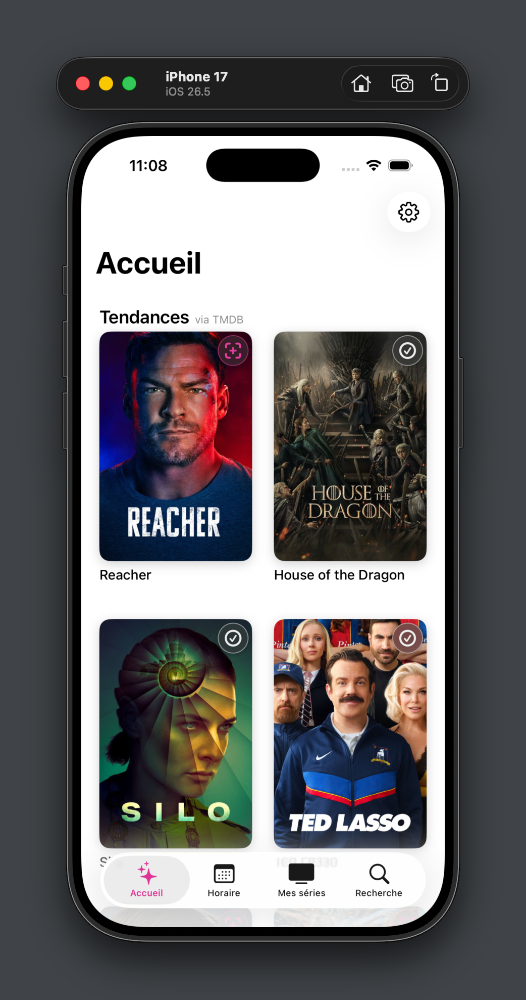
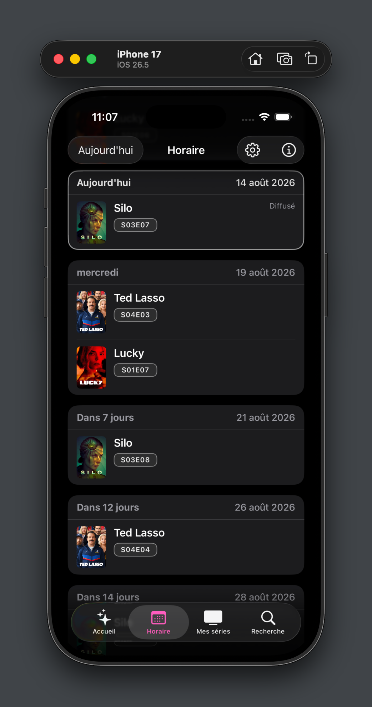
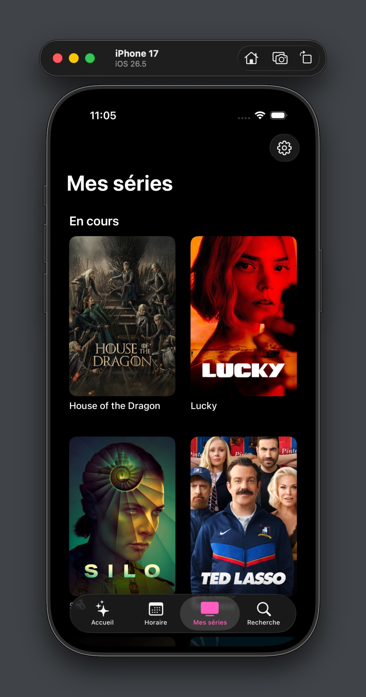
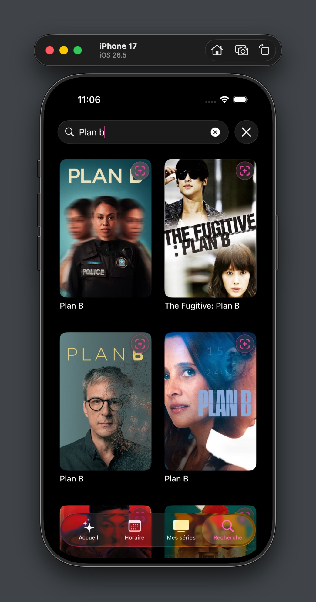
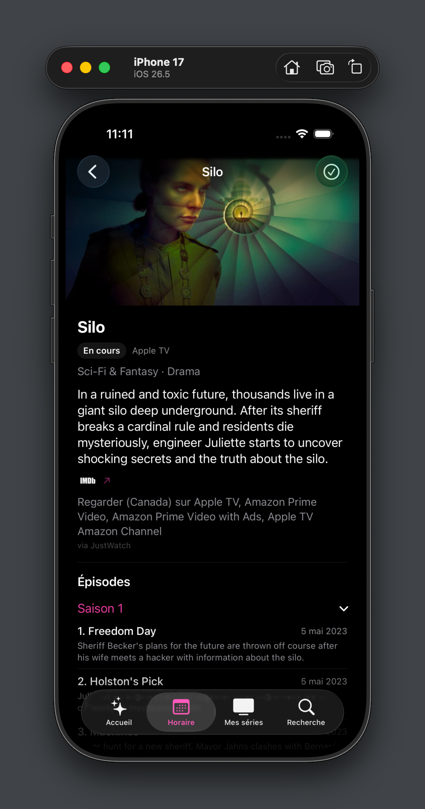
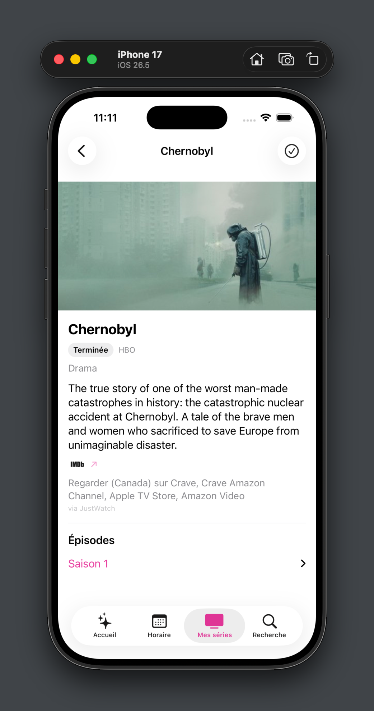

# tvQ

**Ne manquez plus aucun épisode.** tvQ affiche quand sortent les prochains épisodes des séries que vous suivez, à l'heure exacte de diffusion dans votre fuseau horaire, et où les regarder dans votre pays.

Une application iOS native, développée en solo en Swift 6 et SwiftUI.

*[English version](README.md)*

| Accueil | Horaire | Mes séries |
|---|---|---|
|  |  |  |

| Recherche | Fiche série (sombre) | Fiche série (clair) |
|---|---|---|
|  |  |  |

## Points forts

- **Concurrence stricte de Swift 6.** Compilée en mode Swift 6 : isolation au `MainActor` par défaut, SwiftData confiné dans des stores `@ModelActor`, et des modèles immuables `Sendable` qui circulent entre eux.
- **Un cache à trois niveaux avec stale-while-revalidate.** SwiftData en local d'abord, puis un cache Firestore partagé par tous les utilisateurs, puis les API de TMDB et de TVmaze. Une donnée périmée s'affiche aussitôt et se rafraîchit en arrière-plan : l'horaire n'attend jamais le réseau.
- **Deux API réunies en un seul horaire.** TMDB fournit le contenu (titres, synopsis, saisons, images) et TVmaze, l'heure de diffusion précise avec son fuseau horaire. Quand TVmaze n'a pas la série, l'app se rabat sur la date de TMDB sans inventer d'heure.
- **Où regarder, selon le pays.** Les offres en streaming, en location et à l'achat pour le Canada, les États-Unis, la France et le Royaume-Uni, avec la fusion des doublons de catalogue (Disney Plus et Disney+, Netflix avec pub).
- **Des notifications de nouveaux épisodes, sans serveur.** Des notifications locales programmées à partir de l'horaire en cache : à l'heure exacte de diffusion quand TVmaze la connaît (un instant fixe, juste dans n'importe quel fuseau), sinon à une heure du matin choisie. Avant le début, au début ou après la fin de chaque épisode selon sa durée, avec une cloche pour couper n'importe quelle série.
- **Aucune clé d'API dans le binaire.** Le jeton TMDB vient de Firebase Remote Config et peut être changé depuis la console sans nouveau build : un jeton refusé (401) déclenche aussitôt une nouvelle récupération et un nouvel essai, au plus une fois par minute. Firestore est verrouillé par des règles de sécurité testées dans l'émulateur, et App Check limite l'accès aux vraies installations.
- **Sign in with Apple et suppression de compte** conformes aux exigences de l'App Store, y compris la révocation du jeton Apple.
- **Bilingue** (français et anglais), pour l'interface comme pour le contenu des séries.

## Technologies

| | |
|---|---|
| Interface | SwiftUI, Observation (`@Observable`) |
| Langage | mode Swift 6, iOS 27.0 |
| Concurrence | `async`/`await`, actors, `@ModelActor`, groupes de tâches |
| Stockage local | SwiftData |
| Backend | Firebase Auth (Sign in with Apple, courriel), Cloud Firestore, Remote Config, App Check, Crashlytics |
| Notifications | UserNotifications (locales) |
| Données | [TMDB](https://www.themoviedb.org/), [TVmaze](https://www.tvmaze.com/), [JustWatch](https://www.justwatch.com/) par TMDB |
| Tests | Swift Testing, émulateur Firebase (règles de sécurité), XCTest (temps de lancement) |

## Architecture

Un MVVM léger, à la mesure d'un projet en solo. Les données circulent toujours dans le même sens :

```
Views  →  ViewModels  →  Repositories  →  Services  (TMDB, TVmaze, Firebase)
                                       →  Stores    (SwiftData)
```

- **Les vues et les ViewModels** gèrent l'état des écrans. Les ViewModels ne connaissent que les repositories.
- **Les repositories** décident *quand* utiliser le cache ou le réseau. C'est la seule couche qui connaît à la fois TMDB et TVmaze, et une instance unique partagée permet à deux écrans qui demandent la même série de partager un seul appel réseau.
- **Les services** enveloppent chacun un système externe, sans aucune logique de cache.
- **Les stores** sont des actors autour de SwiftData. Ils retournent des modèles simples, jamais des entités SwiftData : rien de non `Sendable` n'en sort.

Les protocoles n'apparaissent que là où ils sont utiles : à la frontière avec les systèmes externes (TMDB, TVmaze, Firestore, Remote Config), pour que les tests puissent injecter des doublures. Le code de l'app utilise toujours les vraies implémentations par défaut.

## Décisions techniques

- **Les règles de fraîcheur sont à un seul endroit** (`CachePolicy`). Une série terminée n'expire jamais, puisqu'elle n'aura plus de nouveaux épisodes.
- **Une copie du cache partagé garde sa date de synchronisation d'origine** quand elle est recopiée en local : une donnée ancienne ne redevient pas « fraîche » en changeant de place.
- **La clé de cache inclut la langue du contenu.** Le cache Firestore est commun à tous les utilisateurs et le contenu est traduit : deux utilisateurs de langues différentes ne peuvent pas écraser les données l'un de l'autre.
- **L'horaire est une seule requête par date.** Plutôt que de charger tous les épisodes de chaque série, l'app s'assure que chaque série est en cache local, puis lit les épisodes récents et à venir en une seule requête SwiftData.
- **Seules les trois dernières saisons sont mises en cache.** L'horaire et les notifications n'ont besoin que de la saison en cours ; les plus anciennes se chargent à la demande, quand on les ouvre dans la fiche. Une quotidienne de plusieurs centaines d'épisodes ne coûte plus des centaines de lignes.
- **Les notifications sont d'abord un plan, puis appliquées.** `NotificationPlanner` transforme les épisodes en une liste de notifications, sans effet de bord (et entièrement testé) ; un mince `NotificationScheduler` remplace celles qui sont en attente. Des identifiants stables rendent la reprogrammation idempotente, et le plan reste sous la limite de 64 notifications d'iOS.
- **La permission est demandée en contexte**, après le suivi d'une première série, jamais au lancement.
- **`currentUser` a une source de vérité unique** : le flux d'authentification de Firebase. La connexion, la déconnexion et la suppression de compte mettent toute l'app à jour sans code supplémentaire.

## Ce que j'ai appris

- **Adapter l'architecture au projet.** J'ai commencé avec une Clean Architecture complète (couches Domain, Data et Presentation, un protocole par repository), puis je l'ai retirée : pour un seul développeur, elle ajoutait des intermédiaires sans ajouter de sécurité.
- **Mesurer avant d'optimiser.** La lenteur de l'écran Horaire ne venait pas de l'horaire lui-même, mais des séries résolues une à une. Les résoudre en parallèle a fait gagner plusieurs secondes au lancement.
- **Le passage au mode Swift 6 en valait la peine.** Le compilateur a trouvé de vrais problèmes : un jeton Firebase non `Sendable` qui traversait une frontière entre actors, et un `[weak self]` qui restait en fait une référence forte pendant toute la durée d'un flux.
- **Les tests manuels trouvent ce que les tests unitaires ne voient pas.** Changer le jeton dans la console a montré que l'app avait besoin de deux relancements pour s'en remettre. La correction (nouvelle récupération sur un 401) est maintenant couverte par des tests qui simulent un changement pendant que l'app tourne.
- **Relire ses propres commentaires d'un œil critique.** Un commentaire promettait que deux écrans partageraient les requêtes en cours, alors que chaque écran avait sa propre instance de repository. Partager les repositories a réglé le problème.

## Tests

Plus de 110 tests unitaires en Swift Testing, sans aucun accès au réseau : de vrais stores SwiftData en mémoire, des doublures pour TMDB, TVmaze et Firestore, et un `URLProtocol` factice pour la couche réseau.

- **Mappers et décodage** : la fusion de TMDB et de TVmaze (heure précise plutôt que date seule, priorité du statut de la série), le dédoublonnage des diffuseurs, et le décodage de toutes les formes de réponse des API, valeurs `null` comprises.
- **Repositories** : toute la cascade du cache (copie fraîche, périmée, partagée, série terminée), le dédoublonnage des requêtes simultanées, un échec d'écriture Firestore qui ne fait pas échouer la requête, la jointure et le tri des saisons.
- **Notifications** : heures exactes et flottantes, sorties de nuit déplacées au matin, replis pour la durée, séries coupées, limite de 64 notifications.
- **Séries suivies** : les mises à jour optimistes annulées en cas d'échec, et aucune donnée d'un ancien compte après une déconnexion pendant le chargement.
- **Jeton TMDB** : premier lancement, lancement hors ligne, appels simultanés qui partagent un seul chargement, changement de jeton pendant que l'app tourne, limitation des récupérations.
- **Couche réseau** : le classement des erreurs (hors ligne, code HTTP, décodage, annulation).

Les règles de sécurité Firestore ont leurs propres tests dans `firestore-tests/` (émulateur Firebase, `npm test`) : un utilisateur ne peut jamais lire ni écrire les données d'un autre.

## Installation

Prérequis : Xcode 27, iOS 27.0.

1. Cloner le dépôt et ouvrir `tvQ.xcodeproj`. Les dépendances Swift Package Manager (Firebase) se résolvent au premier build.
2. Copier `Config/Secrets.xcconfig.template` en `Config/Secrets.xcconfig` et y ajouter un jeton de débogage App Check (`uuidgen`).
3. Ajouter votre propre `GoogleService-Info.plist` de Firebase dans le dossier `tvQ/`, avec Sign in with Apple et Firestore activés.
4. Dans Firebase Remote Config, créer un paramètre de type chaîne `tmdb_token` contenant un jeton d'accès en lecture [TMDB](https://www.themoviedb.org/settings/api) (gratuit), puis publier. Le jeton n'est jamais compilé dans l'app : on peut le changer depuis la console sans nouveau build.
5. Compiler et lancer.

Ces deux fichiers sont volontairement exclus du dépôt.

## Prochaines étapes

- Une version bêta sur TestFlight
- Une Live Activity les soirs de diffusion : un compte à rebours sur l'écran verrouillé et dans la Dynamic Island
- Une page « Tendances » basée sur les séries les plus suivies par les utilisateurs de tvQ
- Le déverrouillage par Face ID au lancement

## Structure du projet

```
tvQ/
├── App/            Point d'entrée et navigation racine
├── Core/           Réglages, configuration des API, jeton TMDB (Remote Config)
├── Models/         Show, Episode, ShowSummary, WatchAvailability, AppUser
├── Notifications/  NotificationPlanner, NotificationScheduler
├── Repositories/   ShowRepository, ScheduleRepository, CachePolicy
├── Services/       TMDB, TVmaze, Firebase, mappers, NetworkService
├── Stores/         Entités et stores SwiftData, cache d'images
└── Views/          Écrans et leurs ViewModels
tvQTests/           Tests unitaires (Swift Testing)
firestore-tests/    Tests des règles de sécurité Firestore (émulateur)
```

## Crédits

Données des séries fournies par [TMDB](https://www.themoviedb.org/) (ce produit utilise l'API de TMDB, mais n'est ni approuvé ni certifié par TMDB) et [TVmaze](https://www.tvmaze.com/). Disponibilité en streaming fournie par [JustWatch](https://www.justwatch.com/).
